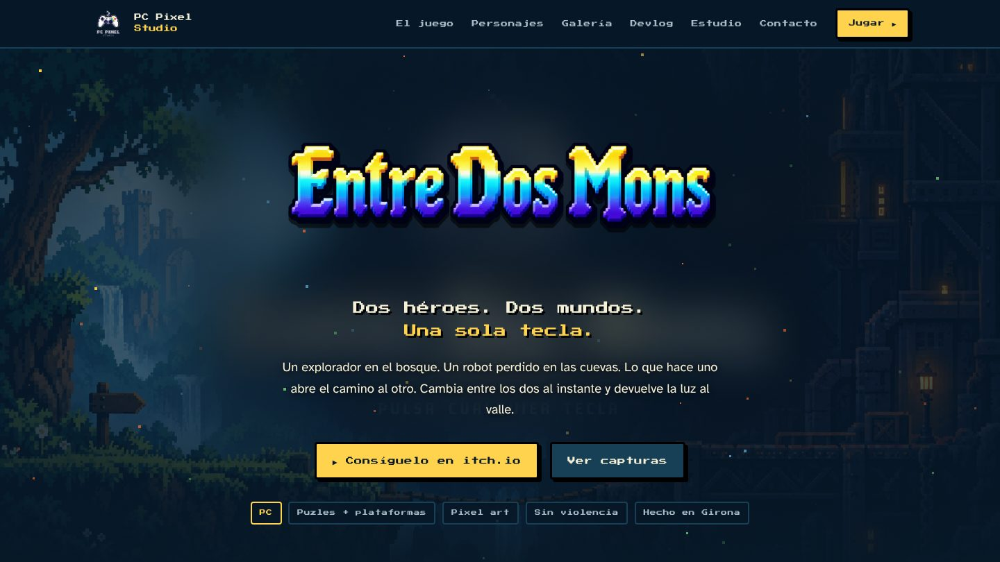
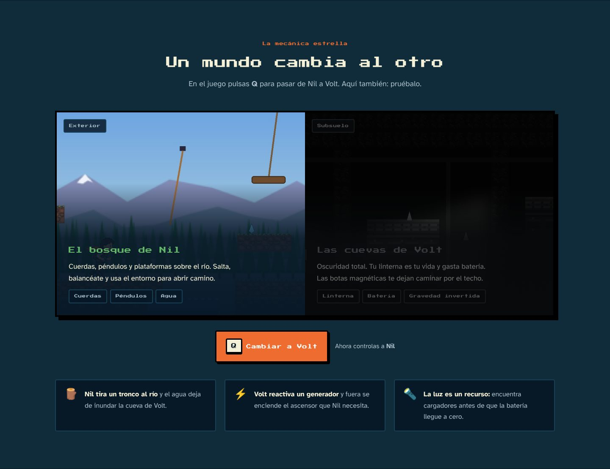
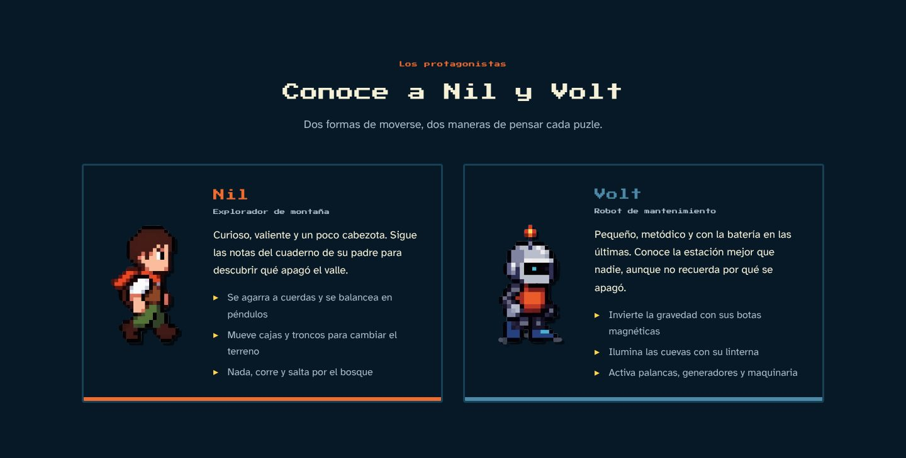
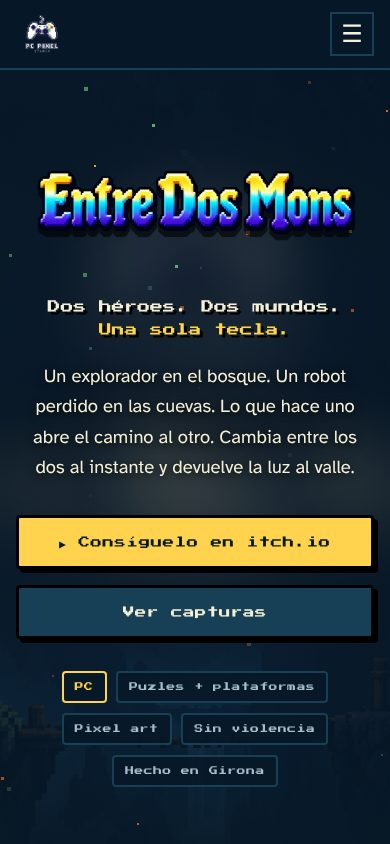

<div align="center">



# Entre Dos Mons · Web oficial

**Dos héroes. Dos mundos. Una sola tecla.**

La página web de **Entre Dos Mons**, la aventura 2D de puzles y plataformas en pixel art de **PC Pixel Studio**. Su objetivo es simple: que quien entre se enamore del juego y acabe jugándolo.

[](https://pabloabaad25.itch.io/entre-dos-mundos)
[](https://www.instagram.com/pcpixelstudio_oficial/)
[](https://github.com/CyrailJR11/Projecte-Intermodular-de-Desenvolupament-d-Aplicacions-Multiplataforma)


[▶ Jugar](https://pabloabaad25.itch.io/entre-dos-mundos) ·
[Qué hay en la web](#-qué-hay-en-la-web) ·
[Verla en local](#-verla-en-tu-ordenador) ·
[Estructura](#-estructura) ·
[Estilo visual](#-estilo-visual)

</div>

---

## 🎮 El juego en 20 segundos

Una estación de investigación escondida bajo la montaña se ha apagado y el valle se ha quedado a oscuras. **Nil**, un joven explorador, sube por el bosque con el cuaderno de su padre. **Volt**, un pequeño robot de mantenimiento, despierta en las cuevas con la batería casi vacía.

Cambias entre los dos con **una sola tecla**, y lo que hace uno abre el camino al otro: si Nil tira un tronco al río, el agua deja de inundar la cueva de Volt; si Volt reactiva un generador, fuera se enciende el ascensor de Nil.

---

## ✨ Qué hay en la web

La portada está pensada como una **landing de venta**: cada sección empuja al visitante hacia el botón de jugar.

| Sección | Para qué sirve |
|---|---|
| **Portada** | Arte del juego, logo, el gancho *«Dos héroes. Dos mundos. Una sola tecla.»* y el botón principal a itch.io. |
| **La historia** | Presenta el conflicto (el valle sin luz) y a los dos protagonistas en pocas líneas. |
| **Un mundo cambia al otro** | Demo interactiva: pulsa **Q** (o el botón) y cambias de Nil a Volt, igual que en el juego. |
| **Personajes** | Fichas de Nil y Volt con sus sprites reales y sus habilidades. |
| **Por qué te va a gustar** | Las 6 razones para jugar: cambio instantáneo, gravedad invertida, física, linterna, pixel art y reto sin violencia. |
| **Galería** | Capturas del juego con visor a pantalla completa. |
| **Para fans de** | Celeste, Brothers, Limbo, Hollow Knight: referencias que el jugador ya conoce. |
| **Llamada final** | Póster del juego + botones a itch.io e Instagram. |

<div align="center">

<br><br>

</div>

El resto de páginas comparten cabecera y pie:

- **Devlog**: avances reales del desarrollo (mecánicas, niveles por código, diálogos, tileset).
- **Estudio**: quiénes somos, el local de Sant Narcís (Girona), valores y tecnología.
- **Contacto**: Instagram, itch.io y email.
- **Privacidad** y **Aviso legal**.

### Detalles que suman

- 📱 **Responsive**: menú hamburguesa y maquetación pensada para móvil.

  

- ♿ **Accesible**: enlace «Saltar al contenido», textos alternativos, foco visible, `aria-*` en menú, visor y demo; respeta *reducir movimiento* del sistema.
- ⚡ **Ligera**: sin frameworks ni dependencias; imágenes optimizadas (JPG/PNG comprimidos) y fuentes `woff2` alojadas en el propio repo.
- 🔎 **SEO y redes**: `description`, Open Graph, imagen para compartir (`img/og-image.jpg`) y datos estructurados `VideoGame` (schema.org).
- ✨ **Toques de juego**: partículas tipo luciérnaga en la portada, botones con sombra pixel y aparición suave de secciones.

---

## 💻 Verla en tu ordenador

No necesita instalar nada.

```bash
git clone https://github.com/pabloabaad25/PAGINA-WEB-PROYECTO-FINAL.git
cd PAGINA-WEB-PROYECTO-FINAL
```

Abre `index.html` en el navegador, o mejor, levanta un servidor local para que todo cargue igual que publicado:

```bash
python -m http.server 8000
# y abre http://localhost:8000
```

En VS Code también vale la extensión **Live Server** (clic derecho en `index.html` → *Open with Live Server*).

### Publicarla gratis

Al ser HTML estático se puede subir tal cual a **GitHub Pages** (Settings → Pages → rama `main`, carpeta `/`), Netlify o Vercel.

---

## 📁 Estructura

```
.
├── index.html        Landing del juego
├── devlog.html       Diario de desarrollo
├── studio.html       El estudio
├── contact.html      Contacto
├── privacy.html      Política de privacidad
├── legal.html        Aviso legal
├── style.css         Estilos de todo el sitio
├── script.js         Menú móvil, demo Nil/Volt, galería, partículas
├── fonts/            Press Start 2P + Atkinson Hyperlegible (woff2)
├── img/              Arte del juego, sprites, póster y capturas (img/galeria/)
├── estudio/          Logo y fotos del estudio
├── iconos/           Iconos de redes y herramientas
├── favicons/         Iconos de pestaña
└── docs/             Capturas de la web para este README
```

---

## 🎨 Estilo visual

La web usa la misma identidad que la presentación y el juego.

**Tipografía**

- **Press Start 2P** para títulos, botones y etiquetas.
- **Atkinson Hyperlegible** para el texto, pensada para leerse bien a cualquier tamaño.

**Paleta**

| | Color | Uso |
|---|---|---|
|  | `#071827` | Fondo noche |
|  | `#102B3A` | Secciones y tarjetas |
|  | `#173F55` | Bordes |
|  | `#4B89A6` | Volt y las cuevas |
|  | `#A8BDC7` | Texto secundario |
|  | `#F5F0D8` | Texto principal |
|  | `#FFD34E` | Botón principal y títulos |
|  | `#EE6C2F` | Nil y acentos |
|  | `#62B56B` | El bosque |

Todos los colores están como variables en `:root` dentro de `style.css`, así que cambiar uno lo cambia en toda la web.

---

## 👥 Equipo

**PC Pixel Studio** · Girona

- **Pablo Abad Ortega**
- **Carlos Rodríguez**

Proyecto intermodular del CFGS de Desarrollo de Aplicaciones Multiplataforma (DAM), La Salle Girona.

---

## 📄 Licencias

- Código, textos y arte de la web y del juego: © 2026-27 PC Pixel Studio. Todos los derechos reservados.
- Fuentes **Press Start 2P** y **Atkinson Hyperlegible**: SIL Open Font License 1.1 (ver `fonts/`).

<div align="center">
<br>

**¿Te ha picado la curiosidad?**

[](https://pabloabaad25.itch.io/entre-dos-mundos)

</div>
